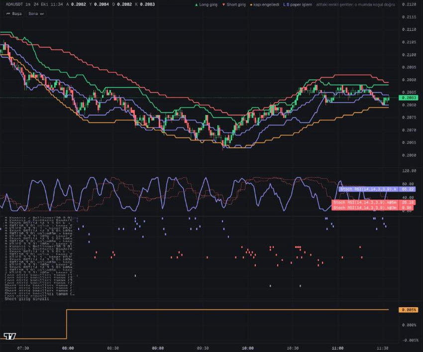
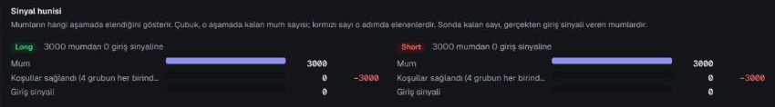

# Merhaba, ben Mert 👋

Yapay zekâyı **gerçek bir işi çözdüğü yerde** kullanan sistemler geliştiriyorum.
Her şeye AI eklemek yerine şunu soruyorum: Bu iş tekrarlanabilir mi, ölçülebilir mi,
hata verdiğinde sistem ayakta kalıyor mu? Kararın deterministik kalması gereken yerde
kod çalışır. Yapay zekâ ise özetleme, denetleme ve hipotez üretme gibi yerlerde değer katar.

- 🔭 Şu an **Trade Hermes** ve **Tradesim** üzerinde çalışıyorum
- 🧩 Odak: pratik AI entegrasyonu, otomasyon, ürünleşmiş SaaS
- ⚙️ Yaklaşım: az bağımlılık, test edilmiş kod, her kararın yazılı bir gerekçesi

## 🔭 Mevcut projeler

### 🪽 Trade Hermes: çok ajanlı kripto işlem sistemi 🔒

Binance futures üzerinde 7/24 çalışan bir işlem sistemi. Şu an **Demo Trading ortamında**,
gerçek para kullanılmadan ölçülüyor.

**İlke: "Kod karar verir, yapay zekâ ders çıkarır."** Dil modelleri ikna edici ama
tekrarlanabilir değil. Bu yüzden işlem sinyalini deterministik bir kural motoru üretiyor:
aynı veriden her seferinde aynı karar çıkıyor. LLM yalnızca dört rolde var:

| Rol | Ne yapar |
|---|---|
| Trader | Orkestrasyon. Sistemi görür ama emir tetiklemez |
| Haber | RSS kaynaklarını tarar, kısa Türkçe özet çıkarır |
| Denetçi | Kapanan her işlemi inceler, ders notu olarak arşivler |
| Spot | Hesaplama modüllerini araç olarak kullanır |

**Güvenlik katmanları**
- Her emrin önünde **8 risk kapısı** var, her biri emri reddedebilir. Pozisyon açıldıktan sonra borsa tarafında stop dahil 4 koruma katmanı devreye girer.
- Gerçek para yolu **iki ayrı kilide** bağlı: ortam bayrağı ve her aktivasyonda ayrıca alınan oturum onayı.
- Strateji değişikliği doğrudan uygulanmaz. Öneri, ardından PR, ardından insan onayı gerekir.

**Gece laboratuvarı:** Sistem uyurken yeni kural hipotezleri üretip kodla ölçüyor. Bir aday canlıya
aday olmadan önce en az 30 gün ve 200 işlem gölgede test ediliyor. İzlenen parite evreni
üç günde bir kendini yeniliyor. Her karar Obsidian vault'una gerekçesiyle yazılıyor.

`Python` · `LangGraph` · `ccxt` · `talipp` · `Redis Streams` · `Parquet + DuckDB` · `Prometheus` · `Telegram`

Tanıtım sitesi, blog ve wiki: [trade-hermes.pages.dev](https://trade-hermes.pages.dev) · Instagram: [@hermestradee](https://www.instagram.com/hermestradee/)

### 🧪 Tradesim: strateji eşleşme simülatörü 🔒

Gösterge, kural ve kapıları tek tek ya da birlikte seçip **Binance verisi üzerinde replay ve canlı
paper** olarak çalıştıran bir araç. Her mumda hangi koşulun geçtiği, hangisinde takıldığı görünüyor.
Bir eşleşme beğenilirse "Kaydet" ile vault'a not olarak yazılıyor. Hermes'e gidecek fikirler burada
sınanıyor. İki proje kod paylaşmıyor, yalnızca fikir taşınıyor.

- **Kural motoru:** 17 gösterge (RSI, MACD, ADX, WaveTrend, SMI, Faytterro Bands…), 11 operatör, Long/Short × giriş/çıkış grupları ve 1 dakikadan 4 saate kadar 10 zaman diliminde çalışan koşullar
- **9 kapı:** funding (Binance, Bybit, OKX ve Hyperliquid birlikte), OI değişimi, long/short oranı, BTC duvarı, volatilite…
- **Simülasyon:** komisyon, kayma ve funding hesaba katılıyor. SL/TP ve trailing stop var. Canlı modda Binance WebSocket kullanılıyor ve oturum kaldığı yerden devam ediyor.
- **Doğrulama:** 526 bin dakikalık mum eksiksiz arşivlendi, rastgele seçilen 8 000 mum Binance ile birebir karşılaştırıldı. Gösterge değerleri pandas-ta, talipp ve TradingView ile çapraz test edildi. Testler, kapanmamış bir mumun hiçbir sinyale giremediğini (look-ahead yasağı) de doğruluyor.

> Gerçek işlem açmaz: kodda emir gönderme ya da API anahtarı yok, yalnızca herkese açık veri okunuyor.

`Python` · `FastAPI` · `pandas` · `DuckDB` · `Lightweight Charts` · `pytest`

**Arayüzden** (Binance'ten alınmış gerçek ADAUSDT 1m verisi, replay modu):

Grafik ve altındaki şeritler: hangi mumda hangi koşul sağlandı, hangisi sağlanmadı.

Sinyal hunisi: mumlar aşama aşama nerede elendi.

## 🚀 Diğer projeler

**Köprü AI** 🔒: AI destekli sosyal medya yönetim SaaS'ı. Metin, görsel, video ve müzik üretimi,
içerik takvimi ve otomatik yayın sunuyor. AI sağlayıcıları arasında sağlık izlemeli yönlendirme var.
Model başına maliyet takibi ve kâr marjı koruması yapılıyor. Public API ve MCP sunucusu da var.
`Next.js 16` · `TypeScript` · `Prisma` · `Supabase` · `Gemini`

**BorsaGünlük Otomasyon** 🔒: BIST 100 ve döviz verilerini her gün çekip analiz eden, içerik,
PDF rapor ve web paneli üreten Python otomasyonu. `Python` · `Flask`

**[Fu&Me Çatı](https://github.com/Teaky44/fumecati)** · [fumecati.com](https://fumecati.com):
yerel SEO odaklı firma sitesi. İlçe bazlı sayfalar ve 16 blog yazısı içeriyor. `HTML` · `CSS` · `JS`

**[Yemeksepeti Telegram Bot](https://github.com/Teaky44/yemeksepetitelegrambot)**: Kodu doğrulayıp
tek kullanımlık grup davet linki üreten bot. `Python` · `python-telegram-bot`

## 🛠️ Teknolojiler

> Trading projeleri yatırım tavsiyesi değildir. Strateji eşikleri bilerek yayınlanmıyor.
